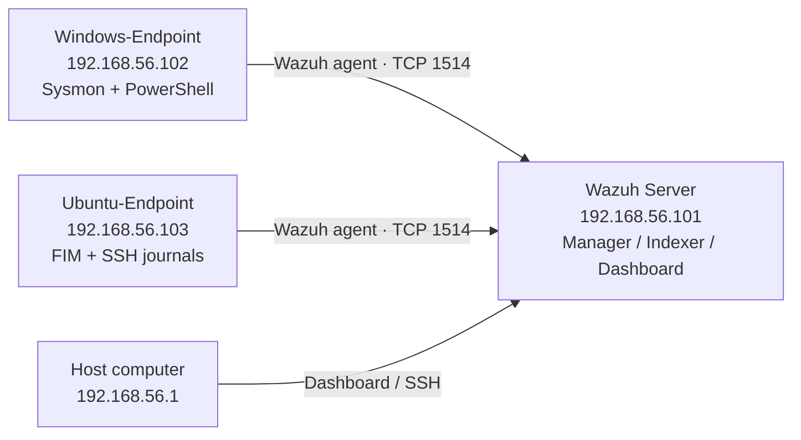
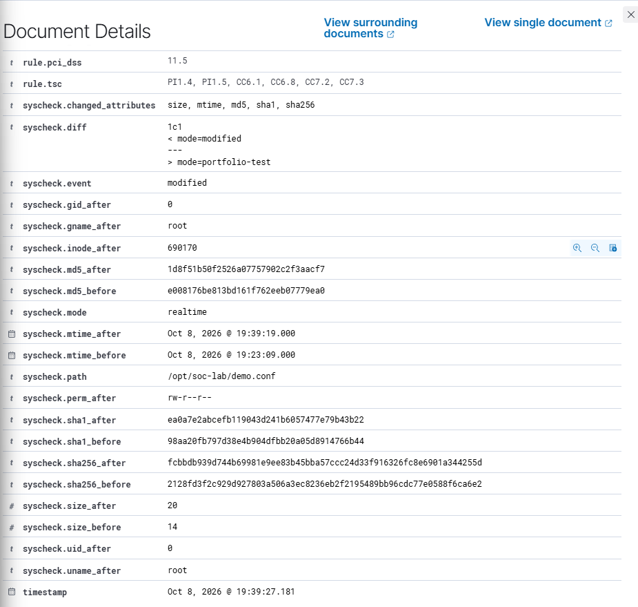

# Home SOC Lab — Wazuh Detection Validation

A hands-on SOC laboratory that centralizes Windows and Ubuntu telemetry, validates detections, and makes the limits of each result explicit.

**8 scenarios · 4 custom Wazuh rules · Windows + Linux · restart validation**

The lab was built and tested between September 30 and October 10, 2026. This repository documents that work; its Git history starts with publication.

## What I built

- A three-VM VirtualBox lab: a Wazuh server, a Windows endpoint and an Ubuntu endpoint.
- Windows process telemetry with Sysmon and script content with PowerShell event 4104.
- Linux file integrity monitoring and SSH authentication monitoring.
- Four custom discovery rules with targeted MITRE ATT&CK mappings.
- Evidence-backed comparisons, legitimate-use controls, configuration exports and restart checks.

## Architecture

The VMs share a host-only network for lab traffic and have separate NAT interfaces for outbound access. [Architecture and network evidence](docs/architecture.md).

## Results at a glance

| Scenario | Test method | Final detection | Outcome |
|---|---|---|---|
| [T1057 — Process Discovery](docs/scenarios/t1057.md) | Atomic test 2: tasklist | Custom 100100 | Explicit T1057 mapping |
| [T1082 — System Information Discovery](docs/scenarios/t1082.md) | Atomic test 1: systeminfo | Custom 100101 | Explicit T1082 mapping |
| [T1016 — Network Configuration Discovery](docs/scenarios/t1016.md) | Atomic test 1, focused on ipconfig /all | Custom 100102 | Executable + argument match |
| [T1033 — System Owner/User Discovery](docs/scenarios/t1033.md) | Partial Atomic test, then manual whoami | Custom 100103 | Targeted behavior validated |
| [Ubuntu — File Integrity Monitoring](docs/scenarios/ubuntu-fim.md) | Controlled text-file edit | Native 550 | Before/after content and hashes |
| [Ubuntu — SSH Authentication](docs/scenarios/ubuntu-ssh.md) | Three wrong passwords, then a valid login | Native 5760 / 5715 | Failure and success distinguished |
| [PowerShell / Registry Modification](docs/scenarios/powershell-registry.md) | Manual lab registry value | Native 91843 | Script text and action verified |
| [T1083 — File and Directory Discovery](docs/scenarios/t1083.md) | Manual adaptation of Atomic test 2 | Native 91820 | Recursive enumeration detected |

For the first four scenarios, Wazuh **already generated generic alerts**. The custom rules improved descriptions and behavior-specific MITRE mappings; they did not turn an undetected event into a detected attack.

### Example: a custom discovery rule

### Example: native Linux file integrity monitoring

## Explore the project

- [Setup and configuration](docs/installation.md)
- [Detailed results and measurement criteria](docs/results.md)
- [Custom rules and their limitations](rules/wazuh/README.md)
- [Restart checks and backups](docs/validation.md)
- [Limitations and next improvements](docs/limitations.md)
- [Evidence index](docs/evidence.md)
- [Five-minute demonstration](docs/demo.md)

## What these results do — and do not — prove

The eight scenarios produced the expected targeted results in this lab. They do not establish complete coverage of eight ATT&CK techniques or a production detection rate.

Legitimate administration can trigger the discovery rules. T1033's original Atomic test failed partly because WMIC was unavailable; the subsequent whoami validation was manual. T1083 was also a scoped manual adaptation. An ATT&CK label on an alert is not proof of malicious intent.

## Reproduce a scenario

Start with the [setup guide](docs/installation.md), check both agents are active, then follow a scenario page. Each page states the executed command, observed telemetry, rule, expected query and practical limits.

The XML files in [configs](configs/README.md) are examples and reviewed lab exports. VM disks, snapshots, enrollment secrets and private keys are not included. The original Sysmon configuration is not available in this repository, so a fresh build must choose and validate its own process-creation configuration.

## Résumé en français

Laboratoire SOC personnel avec Wazuh, Windows et Ubuntu : huit scénarios testés, quatre règles personnalisées, collecte Sysmon/PowerShell, surveillance FIM et SSH. Les résultats sont documentés avec leurs limites et des vérifications après redémarrage.

## Tools and references

[Wazuh](https://documentation.wazuh.com/current/) · [Sysmon](https://learn.microsoft.com/en-us/sysinternals/downloads/sysmon) · [Atomic Red Team](https://github.com/redcanaryco/atomic-red-team) · [Invoke-AtomicRedTeam](https://github.com/redcanaryco/invoke-atomicredteam) · [MITRE ATT&CK](https://attack.mitre.org/)

Screenshots retain the original French interface. No overall before/after detection percentage is claimed.
