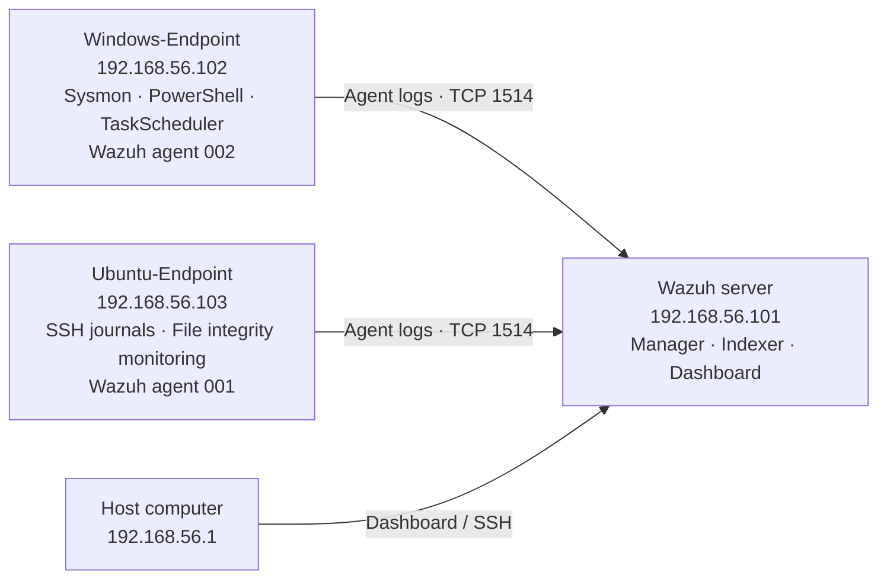
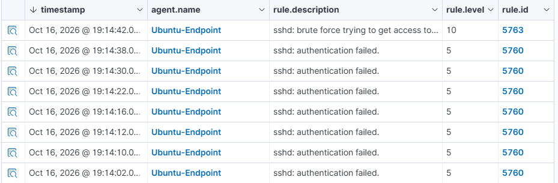
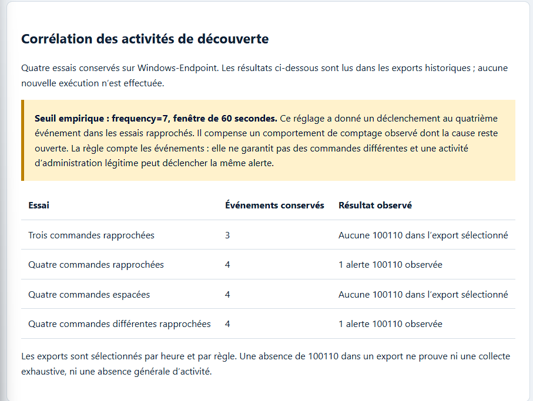

# Home SOC Lab · Wazuh

A student-built lab for collecting Windows and Linux logs, investigating alerts, and checking what the evidence actually demonstrates.

**Wazuh · Sysmon · Windows · Ubuntu · Python · VirtualBox**

[Architecture](docs/architecture.md) · [Scenarios](docs/scenarios/README.md) · [Python tools](docs/python-tools.md) · [Results & limits](docs/results-and-limits.md) · [V1 → V2](docs/evolution-v1-v2.md)

> **En bref :** laboratoire SOC étudiant sur trois VM. La V1 établit la collecte et huit scénarios ; la V2 ajoute des essais de corrélation, des preuves structurées, un rejeu SSH et des outils Python. Les tests sont autorisés et les alertes ne sont pas des incidents confirmés.

## The lab



One Wazuh server receives telemetry from a Windows endpoint and an Ubuntu endpoint. A host-only network carries lab traffic; separate NAT adapters provide outbound access. This is not an Internet-exposed SOC.

## What I practised

| Skill | Practical work |
| --- | --- |
| Log collection | Sysmon process creation, PowerShell script blocks and Ubuntu SSH journals |
| Alert investigation | Comparing commands, source events, rule IDs and endpoint identities |
| Detection rules | Four discovery rules extended with a host-scoped correlation rule |
| Python | Evidence checks, configuration checks, a local HTML report and an SSH replay runner |
| Validation | Positive/negative lab cases, unit tests, source provenance and explicit limitations |

## V2: observed results

| Scenario | Observed result | Evidence |
| --- | --- | --- |
| Windows discovery | Four closely spaced events triggered custom rule 100110; three and widely spaced events did not in the selected exports | [Four comparison cases](docs/scenarios/discovery-correlation.md) |
| PowerShell | Benign plain/encoded commands produced native rules 92027/4 and 92057/12 | [Comparison](docs/scenarios/powershell-encoded.md) |
| Scheduled task | Registration produced native rule 67014/3; local task result: LastTaskResult = 0; cleanup confirmed | [Creation and cleanup](docs/scenarios/scheduled-task.md) |
| Ubuntu SSH | Eight controlled failed logins produced seven 5760/5 alerts, then 5763/10 | [Correlation and replay](docs/scenarios/ssh-correlation.md) |

The V1 work is still available: [eight original scenarios](docs/scenarios/README.md#v1-foundation), including Ubuntu FIM, a PowerShell registry test and file discovery. This is one evolving project, not two unrelated labs.

## A look at the evidence

**Ubuntu: individual failures followed by a native correlation alert**



**Windows: four recorded discovery comparisons**



The second image is a presentation of the exports, not an independent detection test. [Evidence provenance and screenshot notes](evidence/README.md).

## Run the local checks

Python 3.13; standard library only. From the repository root:

```bash
python -m unittest discover -v -s tests -p "test_*.py"
python tools/check_xml.py
python tools/validate_evidence.py tests/fixtures
python tools/generate_report.py tests/fixtures report.html
```

Choose a new output filename when regenerating a report. The program refuses to overwrite an existing file. Report content is in French, matching the lab's analyst notes; it decodes Base64 as text and never executes it.

**Local validation:** **39 unit tests**, four archived-configuration checks and seven evidence checks pass. Tests include rejection of mixed-computer discovery cases and mismatched task source fields. The real SSH engine replay was performed separately on the Wazuh server.

**GitHub Actions:** [a successful published run](https://github.com/AyoubMRN/home-soc-lab-wazuh/actions/runs/38967682383) checked the earlier 33-test revision, archived configurations, evidence and report generation. See [Actions](https://github.com/AyoubMRN/home-soc-lab-wazuh/actions) for later revisions. Unit tests mock the Wazuh subprocess and cannot replace the recorded real-engine replay.

## Important boundaries

- Rule 100110 uses an empirical frequency=7 / 60-second setting; the counting behaviour remains unexplained. Repeating the same command can trigger it.
- A successful Windows EventChannel engine replay has not been established.
- Task creation was detected; detection of task execution in Wazuh is not demonstrated.
- The SSH replay streams events rapidly: timing-boundary and multi-source-IP tests are not included.
- Agent buffer saturation was observed. No exhaustive collection, reliable detection latency, overall detection rate or production false-positive rate is claimed.

Read [results and limitations](docs/results-and-limits.md) before interpreting the screenshots.

## Repository guide

| Directory | Contents |
| --- | --- |
| `docs/` | Architecture, scenarios, procedures, evolution and limitations |
| `configs/` | Custom rules, archived lab settings and separately attributed third-party references |
| `tools/` | Four small Python programs |
| `tests/` | Unit tests and a selected reference corpus |
| `evidence/` | Curated screenshots and recorded SSH replay outputs |
| `.github/workflows/` | Offline checks; no VM credentials or live lab access |

## Project evolution

V2 extends the original Windows and Ubuntu lab with correlation tests, evidence validation and a local Python report. [The V1 snapshot](https://github.com/AyoubMRN/home-soc-lab-wazuh/tree/f13f2e7570baa49a2699d6f3975b3c6383155d6e) remains available in the repository history.

See [sources and third-party credits](docs/sources-and-attributions.md) for the Wazuh rules and Sysmon configuration used in the lab.
