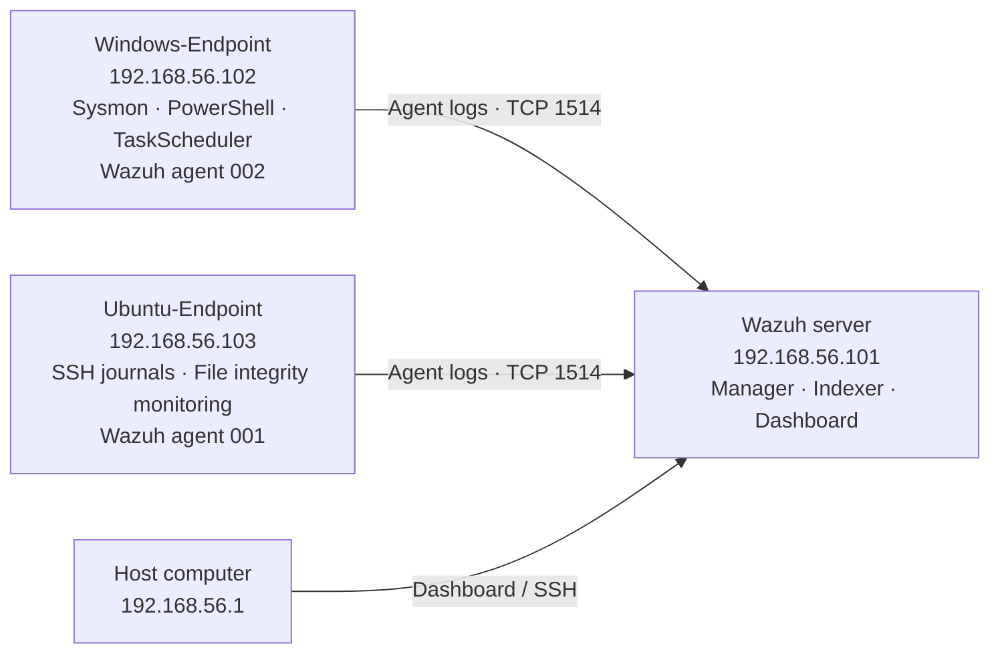
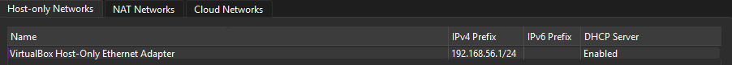
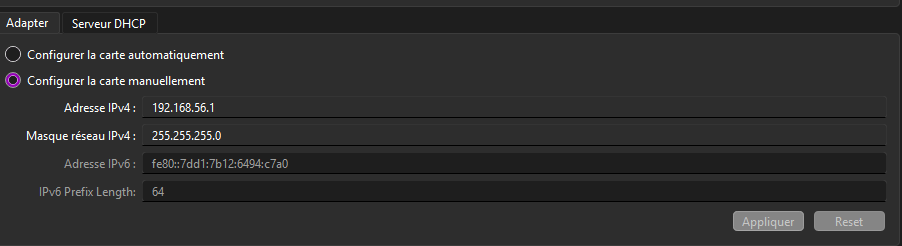

# Architecture

## Machines and traffic

| Component | Lab IP | Role |
|---|---|---|
| Wazuh server | 192.168.56.101 | Manager, Indexer and Dashboard |
| Windows-Endpoint | 192.168.56.102 | Sysmon, Windows PowerShell 5.1, Wazuh agent and Windows tests |
| Ubuntu-Endpoint | 192.168.56.103 | Wazuh agent, FIM and SSH |
| Host | 192.168.56.1 | Browser, SSH and export storage |

The VirtualBox host-only network uses 192.168.56.0/24. Screenshots show DHCP enabled and a host adapter address of 192.168.56.1 with mask 255.255.255.0. Each VM's host-only adapter points to the same VirtualBox Host-Only Ethernet Adapter, with its cable connected. Adapter numbers differ between VMs.

Separate NAT adapters were used for package downloads. This is a home lab, not an Internet-exposed SOC service.

## Telemetry paths

- Windows: Sysmon process creation event 1 → Windows agent → manager analysis → alert indexing → Dashboard.
- PowerShell: Script Block Logging → Operational event 4104 → agent eventchannel collection → native PowerShell rules.
- Ubuntu files: initial FIM baseline → realtime change → native integrity rule.
- Ubuntu SSH: sshd → journald → agent log collection → native authentication rules.

Wazuh and the agents shown in the evidence are version 4.14.8. Ubuntu is 24.04 LTS and Windows is Windows 11 Enterprise Evaluation. The evaluation VM's licensing lifecycle must be considered for future use.

## Network evidence

| VM | Configuration proof |
|---|---|
| Wazuh | [Host-only adapter](screenshots/network/wazuh-adapter.png) |
| Windows | [Host-only adapter](screenshots/network/windows-adapter.png) |
| Ubuntu | [Host-only adapter](screenshots/network/ubuntu-adapter.png) |

## Boundaries

The Ubuntu FIM test uses /opt/soc-lab. Other default paths remain scheduled; they were not all changed to realtime monitoring. The manager's presence does not make every process or command observable: each source needs appropriate endpoint logging and collection.
