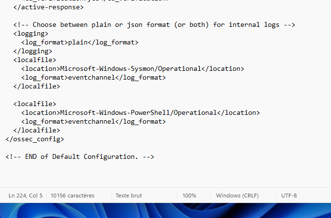
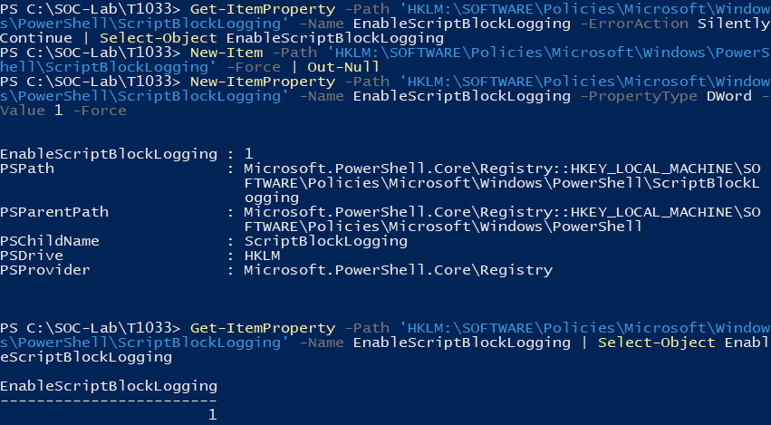

# Setup and reproduction

This guide captures the configuration used for the tested behaviors. It is not a complete unattended VM provisioning script. The original Sysmon XML and an exact Atomic repository commit were not preserved.

## 1. Prepare the VMs

Use VirtualBox with a Wazuh server and Windows/Ubuntu endpoints. The lab used a Wazuh 4.14.8 OVA, Ubuntu 24.04 LTS and Windows 11 Enterprise Evaluation.

Configure a host-only interface on the same network for all three VMs, plus separate NAT interfaces for outbound downloads. Use the lab IP plan in [architecture](architecture.md), or update addresses and agent configurations for your own network.

Provision Wazuh and install/enroll each endpoint agent using the [official deployment guide](https://documentation.wazuh.com/current/installation-guide/wazuh-agent/index.html). Supply your own credentials and enrollment secrets. Confirm both agents are active before testing.

The lab's manager had about 4 GiB RAM and no swap. Dashboard availability problems occurred; the root cause was not conclusively established. For a new build, check the vendor's [quickstart requirements](https://documentation.wazuh.com/current/quickstart.html) and size the host for all running VMs.

## 2. Windows process telemetry

Install Sysmon from [Microsoft Sysinternals](https://learn.microsoft.com/en-us/sysinternals/downloads/sysmon), using a configuration that records process creation event 1. The original lab configuration is not shipped here. Confirm event 1 exists locally:

```powershell
Get-Service Sysmon64
Get-WinEvent -FilterHashtable @{LogName='Microsoft-Windows-Sysmon/Operational'; Id=1} -MaxEvents 3
```

Merge [the event-channel snippet](../configs/windows/event-channels.xml) inside C:\Program Files (x86)\ossec-agent\ossec.conf. Do not duplicate an already configured channel.

## 3. PowerShell Script Block Logging

In Windows PowerShell 5.1 as administrator:

```powershell
New-Item -Path 'HKLM:\SOFTWARE\Policies\Microsoft\Windows\PowerShell\ScriptBlockLogging' -Force | Out-Null
New-ItemProperty -Path 'HKLM:\SOFTWARE\Policies\Microsoft\Windows\PowerShell\ScriptBlockLogging' -Name EnableScriptBlockLogging -PropertyType DWord -Value 1 -Force
Restart-Service WazuhSvc
```

Open a new Windows PowerShell session. Check the setting is 1 and verify event 4104 after a test. This lab collects Microsoft-Windows-PowerShell/Operational, not the separate PowerShell Core channel.

Script text can include sensitive content; use synthetic test data. [Microsoft logging documentation](https://learn.microsoft.com/en-us/powershell/module/microsoft.powershell.core/about/about_logging?view=powershell-5.1).




## 4. Atomic Red Team

Install Invoke-AtomicRedTeam and the atomics folder using the [official installation instructions](https://github.com/redcanaryco/invoke-atomicredteam/wiki/Installing-Invoke-AtomicRedTeam). The observed lab paths are:

- C:\AtomicRedTeam\atomics
- C:\AtomicRedTeam\invoke-atomicredteam\Invoke-AtomicRedTeam.psd1

For a new session:

```powershell
Set-ExecutionPolicy -Scope Process -ExecutionPolicy Bypass -Force
Import-Module C:\AtomicRedTeam\invoke-atomicredteam\Invoke-AtomicRedTeam.psd1 -Force
```

The process-scoped execution policy applies to that window only. Always inspect the selected local test with -ShowDetails. Test numbering and commands can change upstream; compare them with the scenario page and record the version you install.

## 5. Ubuntu FIM and SSH logs

Create /opt/soc-lab and a baseline text file, then merge [the FIM snippet](../configs/ubuntu/fim-snippet.xml) inside the existing syscheck block. Restart the agent and wait for the latest scan to end before modifying the file:

```bash
sudo systemctl restart wazuh-agent
sudo grep 'File integrity monitoring scan ended' /var/ossec/logs/ossec.log | tail -n 3
```

The export also collects journald. Confirm SSH is active and its journal contains local authentication events:

```bash
sudo systemctl is-active ssh
sudo journalctl -u ssh -n 10 --no-pager
```

## 6. Add the custom rules

Back up local_rules.xml on the manager. After checking IDs 100100–100103 are not already allocated, copy [the custom rules](../rules/wazuh/soc-discovery-rules.xml) into /var/ossec/etc/rules/ as a uniquely named XML file. Do not also append the same rules to local_rules.xml.

```bash
sudo /var/ossec/bin/wazuh-analysisd -t
sudo systemctl restart wazuh-manager
sudo systemctl is-active wazuh-manager
```

Restart only after the syntax check succeeds. The lab originally appended these rules to local_rules.xml; the repository extracts them into a separate file and omits the vendor sample rule.

See [Wazuh custom rules](https://documentation.wazuh.com/current/user-manual/ruleset/rules/custom.html).

## 7. Inspect the result

Use Threat Hunting → Events, remove unrelated filters, and choose a time range around execution. Queries in scenario pages use DQL. Open the alert to verify command text, source endpoint, rule and MITRE fields.

This view searches alerts. No visible alert does not establish that a raw event was not collected.
