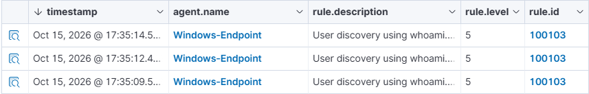
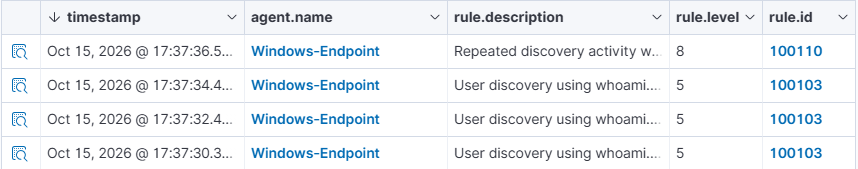
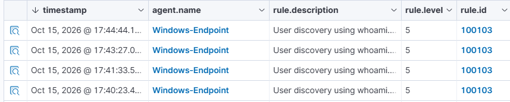
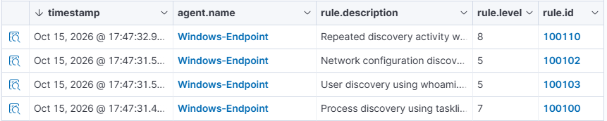

# V2 · Windows discovery correlation

## Goal and method

Compare repeated benign discovery events on Windows-Endpoint, agent 002. Existing discovery rules 100100–100103 were extended with the soc_discovery group; rule 100110 uses if_matched_group, same_field win.system.computer, frequency=7 and timeframe=60, at level 8.

The shared group is an input to counting; the output group is soc_correlation. The rule does not require different programs or establish malicious intent.

The Wazuh agent is named `Windows-Endpoint`, while the Windows source field `win.system.computer` is `Windows-Endpoin`. These are different fields, preserved as recorded rather than normalised. Correlation uses the latter; the evidence validator requires one non-empty computer value across each case and matches each decoded event to its source.

## Four recorded cases

| Case | Preserved events | Observation |
| --- | --- | --- |
| Three close whoami events | 3 | No 100110 in selected export |
| Four close whoami events | 4 | One 100110 at the last event |
| Four spaced whoami events | 4 | No 100110 in selected export; successive alert gaps exceed 60 s |
| Four different close programs | 4 | One 100110; tasklist, whoami, ipconfig /all and systeminfo recorded |

The fixtures named correlation-*.alerts.jsonl preserve these cases. Display sorting does not change original file order. Times in the HTML report measure alert timestamps, not the engine's internal correlation clock.

## Interpretation and limits

frequency=7 is an empirical setting: it produced a fourth-event correlation in these close tests, following unexpected counting/history behaviour in earlier attempts. The root cause remains unresolved. Do not describe this as a portable, precisely four-command production detector. Selected negative exports cannot prove exhaustive collection. No successful Windows EventChannel engine replay was obtained.

The tasklist/systeminfo/ipconfig/whoami executable rules inherited from V1 remain useful, but legitimate use can alert. See [rule deployment boundaries](../../configs/wazuh/custom/README.md) before loading anything.
