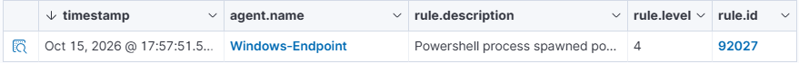

# V2 · Plain versus encoded PowerShell

## Goal and method

Compare two harmless commands that print the same marker, SOC-LAB-V2-PS-ARCHIVE-CHECK. Both were tested in a PowerShell-spawning-PowerShell context on Windows-Endpoint, agent 002. One used -Command, the other -EncodedCommand. No custom PowerShell rule was added.

## Observation

| Form | Native rule | Level | Alert UTC |
| --- | --- | --- | --- |
| Plain | 92027 | 4 | 2026-10-15 15:57:51.550 |
| Base64 | 92057 | 12 | 2026-10-15 16:00:13.147 |

The PowerShell fixtures contain one selected alert each. Their corresponding Sysmon source records are the two selected lines of powershell-comparison.archives.jsonl. Because these alert exports lack full_log, the validator pairs the separate archive records with the alert identity and command. An event 4104 baseline was also observed locally, but a collected event need not generate an alert.

## Interpretation and limits

Base64 is encoding, not encryption. The decoded text is read locally, never executed by the generator. A higher Wazuh level is not a compromise probability. The observed native rule describes a child PowerShell process and does not establish detection of every encoded PowerShell variant.

Temporary JSON archiving was used to preserve the source records and then disabled. This fixture is a two-event selection, not the server's complete archives. Collection buffer saturation was observed during the lab; completeness is not claimed.
