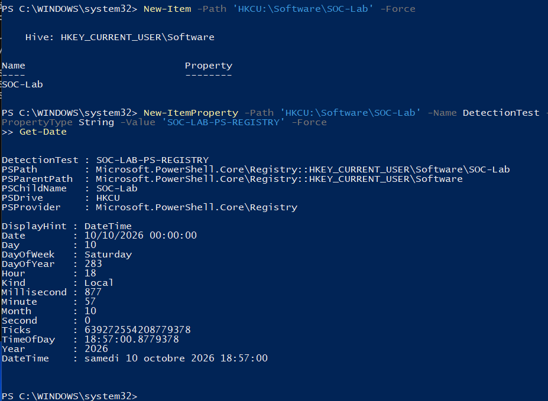
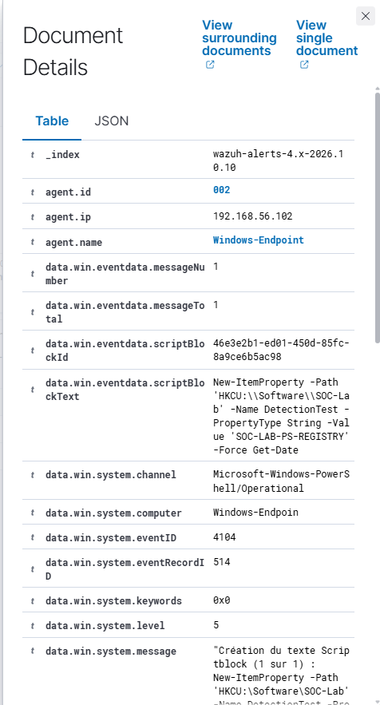
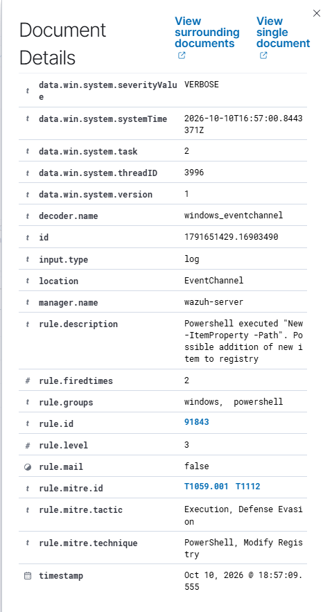
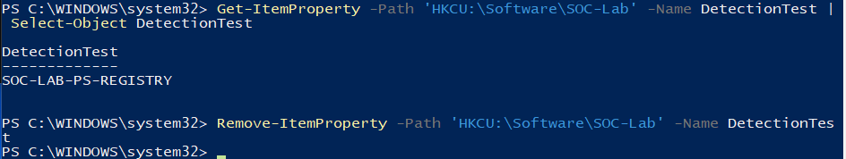

# PowerShell — Controlled Registry Modification

## Goal and method

Confirm that Windows records script content in event 4104, that Wazuh receives it, and that a native rule recognizes a registry-write command. This is a manual synthetic test associated with T1059.001 and T1112.

## Preparation

PowerShell eventchannel collection was added to the agent configuration, and EnableScriptBlockLogging was set to 1. A benign Write-Output marker was then observed locally in event 4104. The marker's individual reception was not established by a Dashboard alert.

During setup, rule 91843 already alerted on the command used to enable logging. That first observation is not a baseline attack test. No custom rule was created.

## Test and cleanup

In Windows PowerShell as administrator:

```powershell
New-Item -Path 'HKCU:\Software\SOC-Lab' -Force
New-ItemProperty -Path 'HKCU:\Software\SOC-Lab' -Name DetectionTest -PropertyType String -Value 'SOC-LAB-PS-REGISTRY' -Force
Get-ItemProperty -Path 'HKCU:\Software\SOC-Lab' -Name DetectionTest | Select-Object DetectionTest
Remove-ItemProperty -Path 'HKCU:\Software\SOC-Lab' -Name DetectionTest
```

The key was dedicated to the lab. The value was read back, then removed; Script Block Logging remains enabled at a different path.

## Observed result

Native rule 91843, level 3, alerted on New-ItemProperty -Path. Event 4104 includes the actual HKCU path, name and value. The alert carries T1059.001 and T1112.

```text
agent.name:"Windows-Endpoint" AND rule.id:"91843"
```






## Interpretation

The action is legitimate administration. Native detection matched script text; that alone would not prove execution success. The separate read-back supplied that evidence.

The first-observation/test-validation comparison uses the same native rule. It is not an improvement in detection effectiveness between two rules. The collection and native rule were validated without adding a marker-specific rule that would only detect our own test string.
