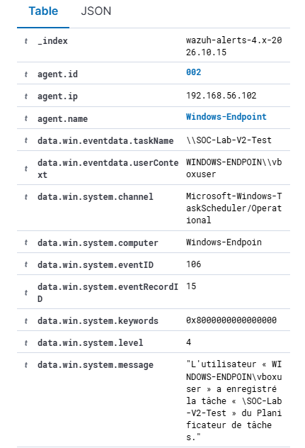
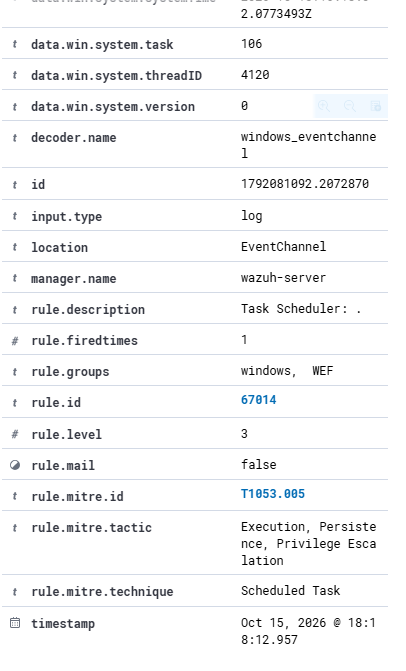
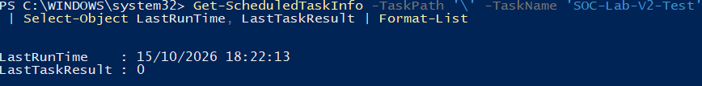
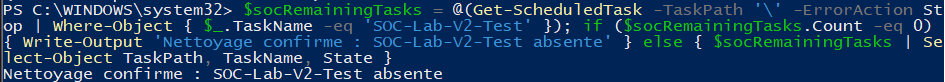

# V2 · Scheduled-task registration

## Goal and method

Create a harmless manual-only task named SOC-Lab-V2-Test, launch it once, inspect the local result and remove it. The TaskScheduler Operational journal was enabled and collected through the Windows agent. The test did not establish malicious persistence.

## Observation

- Endpoint: Windows-Endpoint, agent 002.
- Native Windows event: Microsoft-Windows-TaskScheduler/Operational, event 106, record 15.
- Source UTC: 2026-10-15T16:18:02.0773493Z.
- Wazuh alert: 67014, level 3; UTC 16:18:12.957.
- Recorded account: WINDOWS-ENDPOIN\vboxuser.
- Local run result: 0. The task was then removed and its absence checked.

The validator compares the alert identity, task, computer, provider, source timestamp and channel with scheduled-task-created.event106.xml. It compares the event's systemTime, not the later Wazuh alert timestamp. The [provenance note](../../tests/fixtures/scheduled-task-created.provenance.md) states how that XML was preserved.

## Interpretation and limits

Registration detection is established by the selected records. The local task result is not proof of an execution alert in Wazuh; that detection is not demonstrated. The XML was preserved as text, not as a byte-verified transfer from Windows. The time difference is not a reliable latency benchmark. Unrelated task errors were not treated as evidence for this test.
