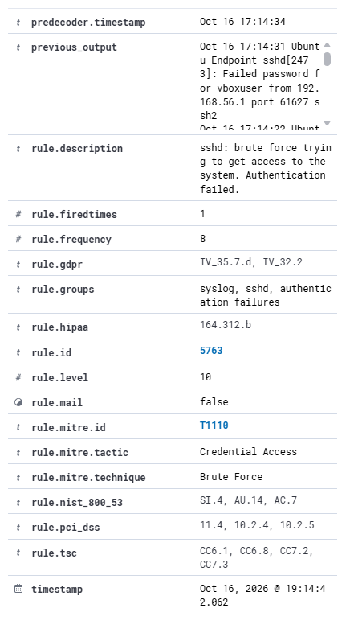
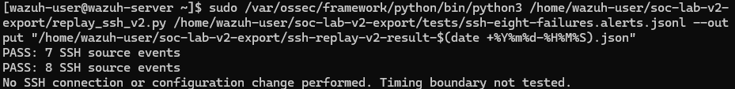

# V2 · Repeated SSH failures on Ubuntu

## Goal and method

Eight authorised login attempts used a deliberately incorrect password against the existing vboxuser account on Ubuntu-Endpoint (agent 001, 192.168.56.103), from the lab host 192.168.56.1. This is a controlled authentication test, not a confirmed intrusion.

## Observation

Seven individual native alerts 5760/5 were followed by one native correlation alert 5763/10. The selected alerts span 17:14:02.002–17:14:42.062 UTC on 16 October 2026. The final source log is dated 17:14:34; source and alert times are not interchangeable.

The archived native rule 5763 uses if_matched_sid 5760, same_source_ip, frequency=8, timeframe=120 and ignore=60. Rule 5712 concerns a different, nonexistent-user path and is not the observed rule for this test.

The fixture contains eight alerts, including all eight full_log source lines and the final previous_output. The validator compares its seven history lines with the seven preceding failures and checks source identity, uniqueness and source-time interval.

## Real-engine replay

The runner was executed on the actual Wazuh manager in two separate logtest sessions: seven source events gave seven 5760/5 results; eight gave seven 5760/5 then 5763/10. It performs no SSH connection or configuration change. [Inputs, outputs and provenance](../../evidence/replay-ssh/README.md).

## Interpretation and limits

The replay streams records immediately and does not test the 120-second boundary or multiple source IPs. The isolated failed login was reviewed separately in the dashboard, not included in this eight-alert fixture. No reliable latency, automatic blocking, production false-positive rate or malicious intent is inferred.
