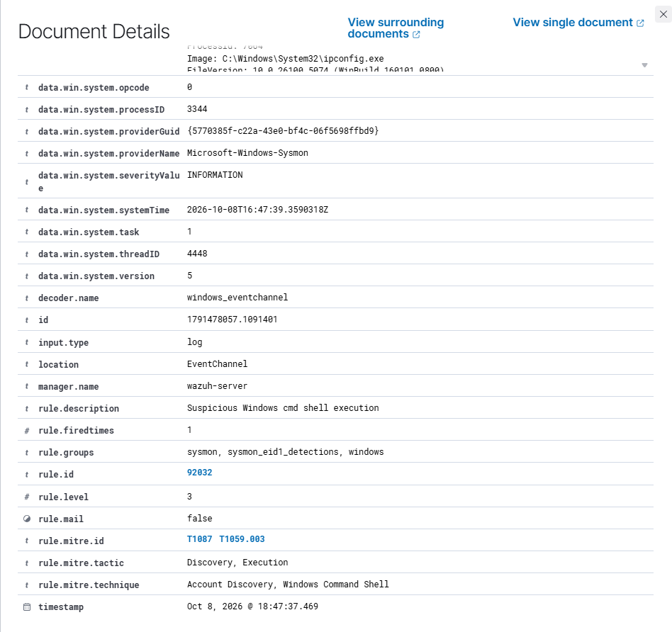
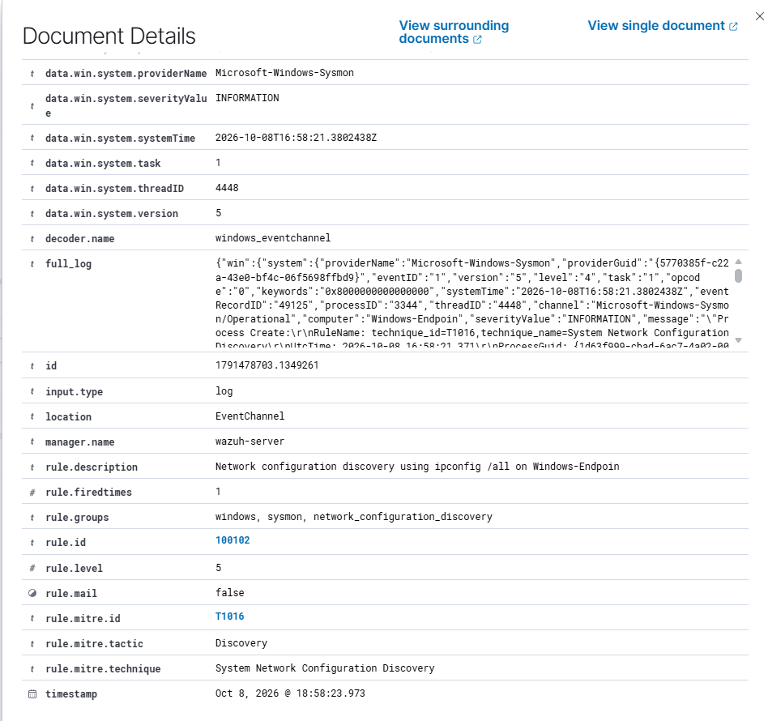
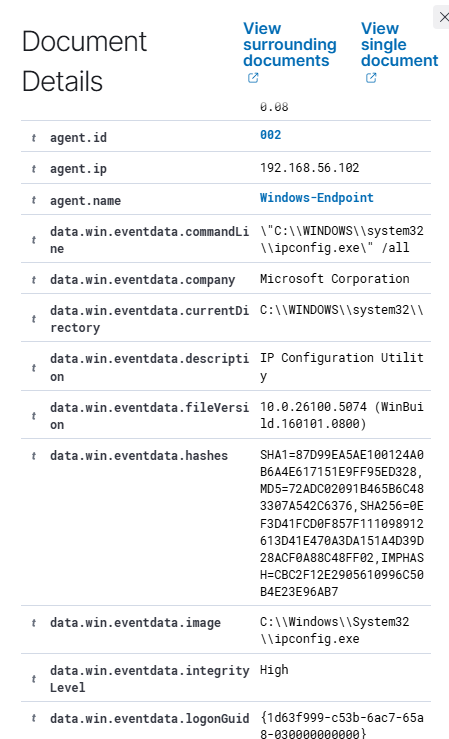

# T1016 — Network Configuration Discovery

## Goal and method

Identify detailed interface configuration queries, with an argument-sensitive rule.

**Method:** Atomic Red Team T1016, test 1; analysis focused on ipconfig /all. Prerequisites: the [setup](../installation.md), active Windows agent and appropriate Sysmon/PowerShell collection.

## Commands used

```powershell
Invoke-AtomicTest T1016 -TestNumbers 1 -PathToAtomicsFolder C:\AtomicRedTeam\atomics
```

For Atomic runs, inspect the locally installed test with -ShowDetails before execution. Test definitions can differ between revisions.

## Observations

**Initial:** The ipconfig /all event generated generic rule 92032, level 3. The examined alert had no T1016 mapping.

**Final:** Custom rule 100102, level 5, requires both ipconfig.exe and the delimited /all argument and maps the event to T1016.

## Dashboard query

```text
agent.name:"Windows-Endpoint" AND rule.id:"100102"
```

Remove unrelated filters and restrict the time range to the execution. Open the alert and verify the image/command or scriptBlockText, agent, rule and MITRE fields.

## Evidence

### Native mapping



### Custom rule and mapping



### Manual legitimate /all use



## Limits

The Atomic test also runs netsh, arp, nbtstat and net config. Those commands are not covered by 100102. Manual ipconfig /all also alerts. No 100102 alert was reported for plain ipconfig, but its local collection proof was not saved.

[Atomic technique definition](https://github.com/redcanaryco/atomic-red-team/blob/master/atomics/T1016/T1016.md) · [Results](../results.md)
