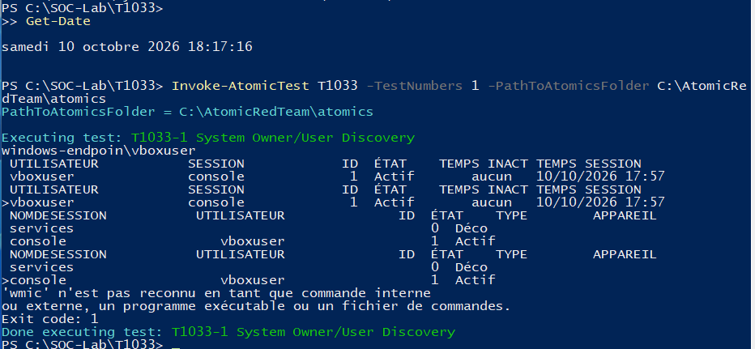
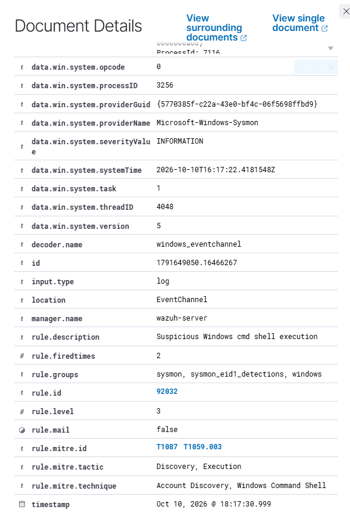
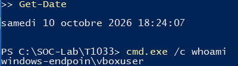
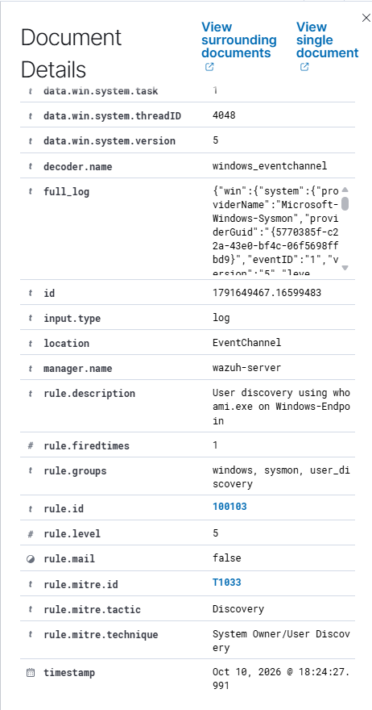

# T1033 — System Owner/User Discovery

## Goal and method

Identify the current Windows account using whoami.exe.

**Method:** Atomic Red Team test 1 partly executed, followed by a targeted manual test. Prerequisites: the [setup](../installation.md), active Windows agent and appropriate Sysmon/PowerShell collection.

## Commands used

```powershell
Invoke-AtomicTest T1033 -TestNumbers 1 -PathToAtomicsFolder C:\AtomicRedTeam\atomics

# Targeted validation after deploying rule 100103:
cmd.exe /c whoami
```

For Atomic runs, inspect the locally installed test with -ShowDetails before execution. Test definitions can differ between revisions.

## Observations

**Initial:** Atomic output lists the account and sessions, but WMIC is unavailable and Exit code: 1 is shown. The whoami event has generic rule 92032.

**Final:** A subsequent manual cmd.exe /c whoami execution triggered custom rule 100103, level 5, with T1033. The behavior was retested after restart.

## Dashboard query

```text
agent.name:"Windows-Endpoint" AND rule.id:"100103"
```

Remove unrelated filters and restrict the time range to the execution. Open the alert and verify the image/command or scriptBlockText, agent, rule and MITRE fields.

## Evidence

### Partial Atomic run with WMIC error



### Initial native mapping



### Manual whoami execution



### Custom rule and T1033



## Limits

The full Atomic test is not marked successful. Only the targeted whoami behavior is validated after the rule change. The command is also used legitimately; the rule does not distinguish intent.

[Atomic technique definition](https://github.com/redcanaryco/atomic-red-team/blob/master/atomics/T1033/T1033.md) · [Results](../results.md)
