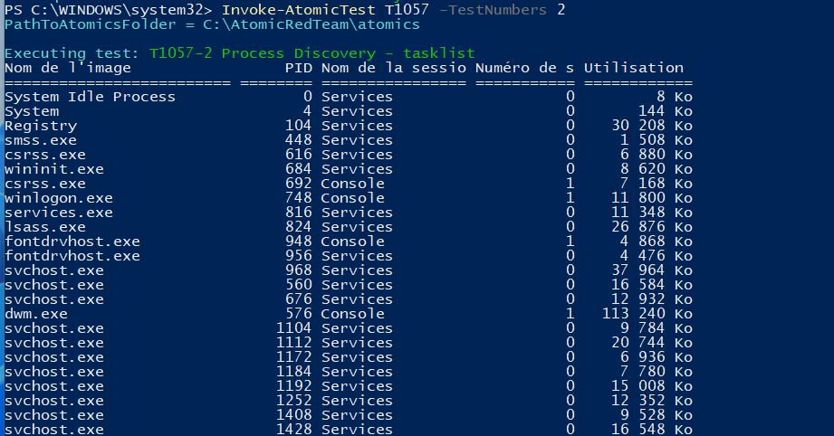
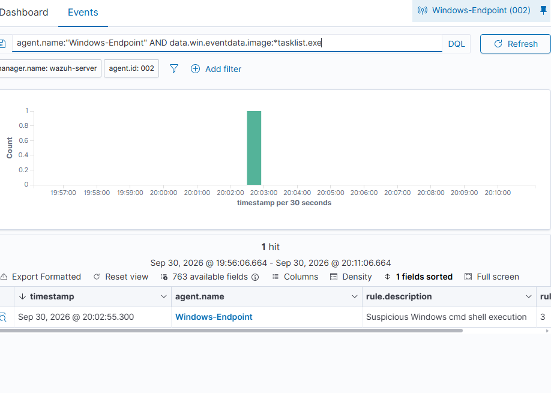
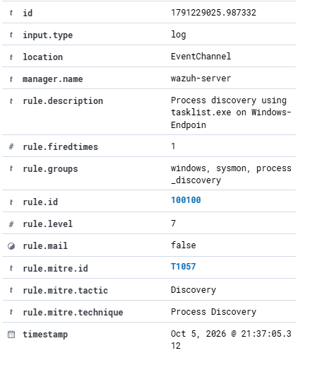
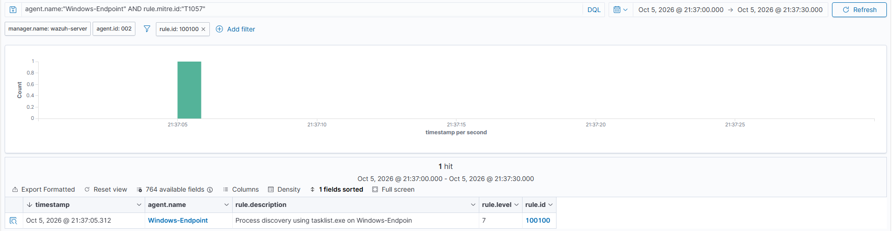

# T1057 — Process Discovery

## Goal and method

Observe tasklist.exe enumerating running processes.

**Method:** Atomic Red Team T1057, test 2. Prerequisites: the [setup](../installation.md), active Windows agent and appropriate Sysmon/PowerShell collection.

## Commands used

```powershell
Invoke-AtomicTest T1057 -TestNumbers 2 -PathToAtomicsFolder C:\AtomicRedTeam\atomics
```

For Atomic runs, inspect the locally installed test with -ShowDetails before execution. Test definitions can differ between revisions.

## Observations

**Initial:** A generic Windows command-shell alert was present. Process telemetry identified tasklist.exe; the examined result did not provide the desired T1057 classification.

**Final:** Custom rule 100100, level 7, maps the targeted event to T1057.

## Dashboard query

```text
agent.name:"Windows-Endpoint" AND rule.id:"100100"
```

Remove unrelated filters and restrict the time range to the execution. Open the alert and verify the image/command or scriptBlockText, agent, rule and MITRE fields.

## Evidence

### Atomic execution



### Initial native alert



### Custom rule and MITRE



### Dashboard search



## Limits

Only the tasklist executable match is validated. Legitimate tasklist use can alert; parent/user context and process-enumeration alternatives are not covered.

[Atomic technique definition](https://github.com/redcanaryco/atomic-red-team/blob/master/atomics/T1057/T1057.md) · [Results](../results.md)
