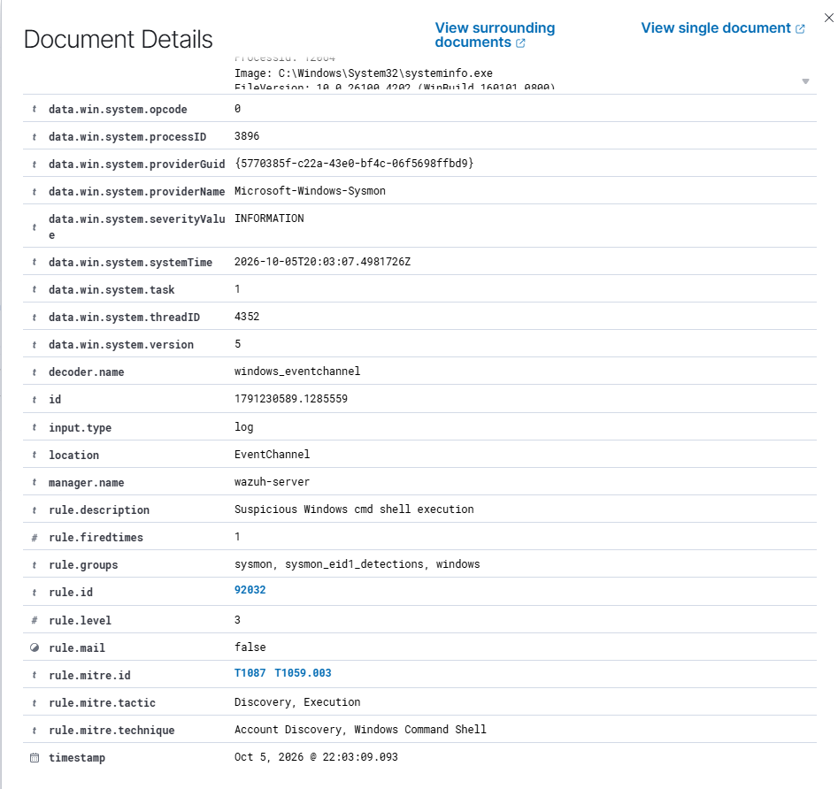
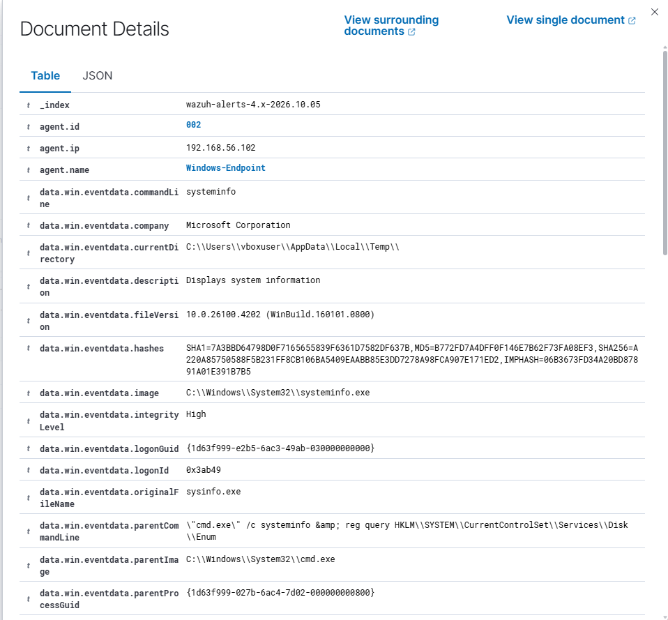
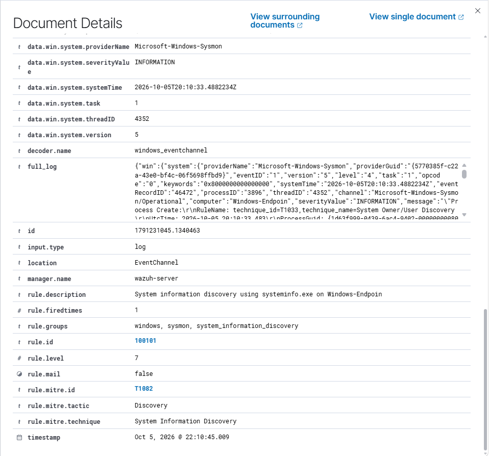

# T1082 — System Information Discovery

## Goal and method

Observe systeminfo.exe gathering operating-system information.

**Method:** Atomic Red Team T1082, test 1. Prerequisites: the [setup](../installation.md), active Windows agent and appropriate Sysmon/PowerShell collection.

## Commands used

```powershell
Invoke-AtomicTest T1082 -TestNumbers 1 -PathToAtomicsFolder C:\AtomicRedTeam\atomics
```

For Atomic runs, inspect the locally installed test with -ShowDetails before execution. Test definitions can differ between revisions.

## Observations

**Initial:** The examined systeminfo event used native rule 92032, level 3, with T1087 and T1059.003 rather than T1082.

**Final:** Custom rule 100101, level 7, gives systeminfo.exe a T1082 mapping.

## Dashboard query

```text
agent.name:"Windows-Endpoint" AND rule.id:"100101"
```

Remove unrelated filters and restrict the time range to the execution. Open the alert and verify the image/command or scriptBlockText, agent, rule and MITRE fields.

## Evidence

### Native rule mapping



### Original command and image



### Custom rule and T1082



## Limits

The Atomic test also queries disk information in the registry. This custom rule validates systeminfo.exe only, and legitimate inventory work can trigger it.

[Atomic technique definition](https://github.com/redcanaryco/atomic-red-team/blob/master/atomics/T1082/T1082.md) · [Results](../results.md)
