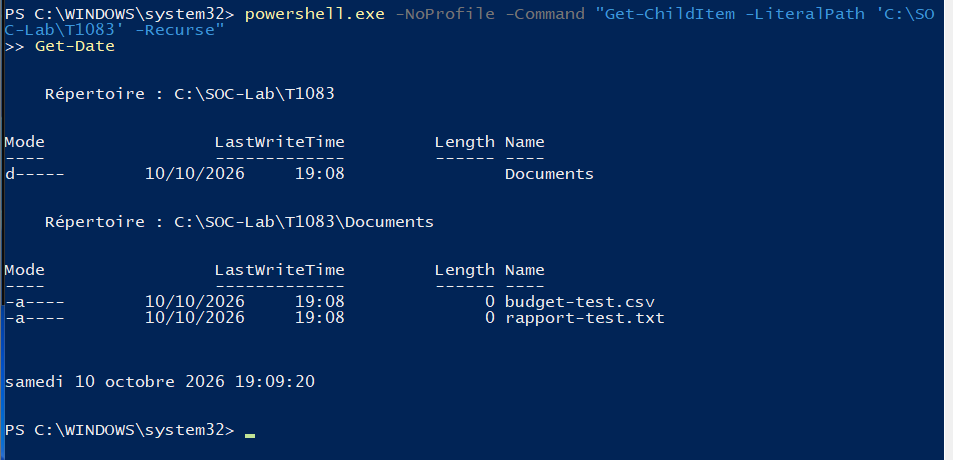
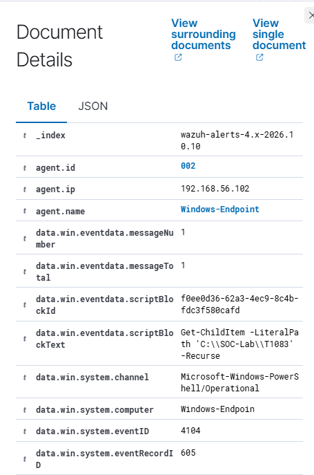
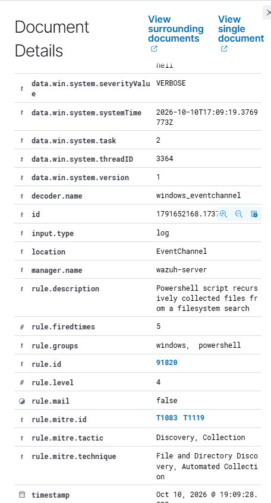

# T1083 — File and Directory Discovery

## Goal and method

List synthetic filenames recursively within a controlled lab directory.

**Method:** Manual adaptation of Atomic Red Team T1083 test 2. Prerequisites: the [setup](../installation.md), active Windows agent and appropriate Sysmon/PowerShell collection.

## Commands used

```powershell
New-Item -ItemType Directory -Path C:\SOC-Lab\T1083\Documents -Force
New-Item -ItemType File -Path C:\SOC-Lab\T1083\Documents\rapport-test.txt
New-Item -ItemType File -Path C:\SOC-Lab\T1083\Documents\budget-test.csv
powershell.exe -NoProfile -Command "Get-ChildItem -LiteralPath 'C:\SOC-Lab\T1083' -Recurse"
```

For Atomic runs, inspect the locally installed test with -ShowDetails before execution. Test definitions can differ between revisions.

## Observations

**Initial:** The original test's ls, Get-ChildItem and gci aliases were inspected with -ShowDetails. A manual explicit-path variant was used to constrain enumeration.

**Final:** Native rule 91820, level 4, detected the recursive listing. Event 4104 contains the exact command. The alert includes T1083 and T1119.

## Dashboard query

```text
agent.name:"Windows-Endpoint" AND data.win.system.eventID:"4104" AND rule.id:"91820"
```

Remove unrelated filters and restrict the time range to the execution. Open the alert and verify the image/command or scriptBlockText, agent, rule and MITRE fields.

## Evidence

### Scoped listing output



### Exact script and event 4104



### Native rule and MITRE



## Limits

This is a manual adaptation, not a complete Atomic execution. The files were empty; the test listed names, without copying content or exfiltrating data. T1119 on the native rule does not prove data collection beyond this listing.

[Atomic technique definition](https://github.com/redcanaryco/atomic-red-team/blob/master/atomics/T1083/T1083.md) · [Results](../results.md)
