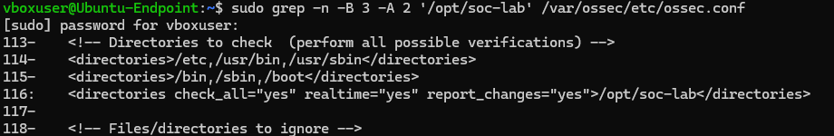
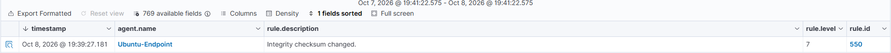

# Ubuntu — File Integrity Monitoring

## Goal

Detect a controlled configuration-file change and show the old/new content. This is a manual FIM test, not an Atomic attack.

## Configuration and execution

Create /opt/soc-lab and a synthetic demo.conf before enabling monitoring. Merge this inside the existing syscheck block:

```xml
<directories check_all="yes" realtime="yes" report_changes="yes">/opt/soc-lab</directories>
```

Restart wazuh-agent and wait for the latest "File integrity monitoring scan ended" message. Then edit demo.conf with nano. The saved evidence shows mode=modified replaced with mode=portfolio-test.

```bash
sudo nano /opt/soc-lab/demo.conf
```

## Result

Native rule 550, level 7, reports modified status, realtime mode, the path, changed attributes and different hashes. The content diff makes the actual replacement visible.

```text
agent.name:"Ubuntu-Endpoint" AND syscheck.path:"/opt/soc-lab/demo.conf" AND rule.id:"550"
```





## Interpretation and limits

The change was authorized. Integrity changes need analysis, not an automatic assumption of compromise. The native rule's T1565.001 label does not establish malicious data manipulation here.

Only /opt/soc-lab was added with these realtime and content-reporting options. Existing default paths remain scheduled. report_changes can retain sensitive file content; this test uses synthetic data.

The first saved modification alert concerned a removed blank line; the later diff above is the meaningful value-change proof. FIM was successfully retested after reboot. No custom rule was needed.
