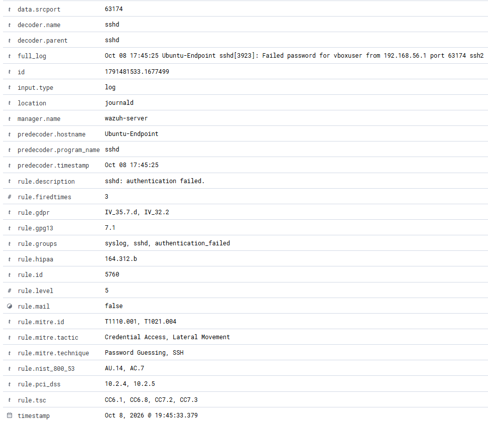
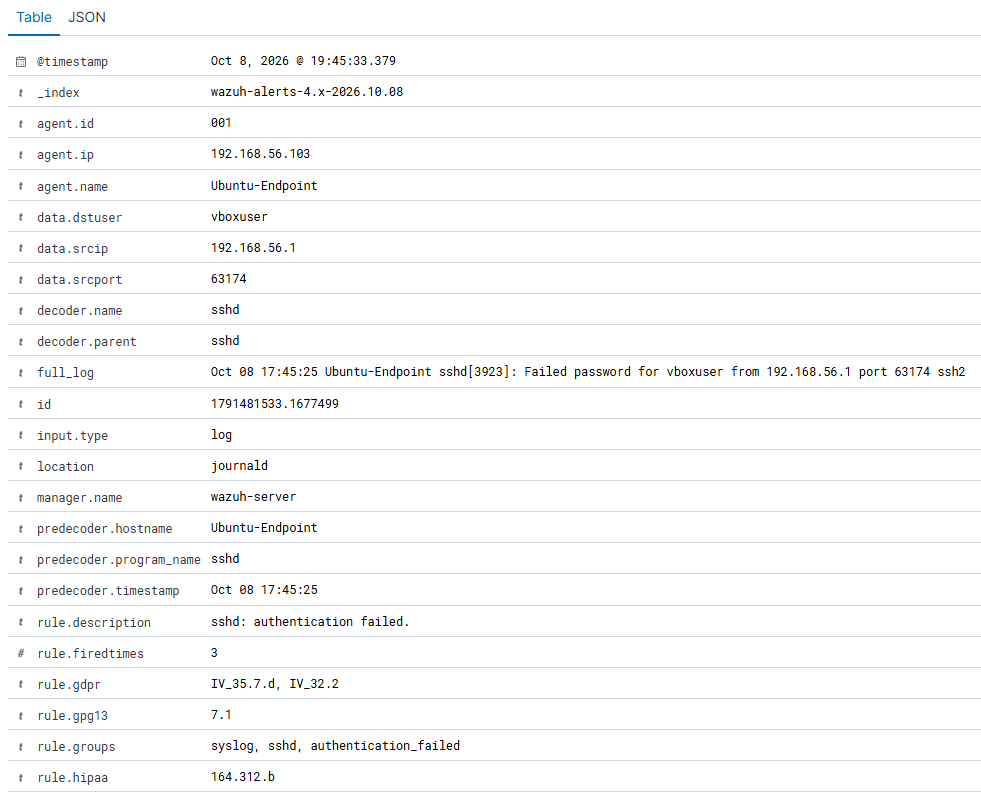
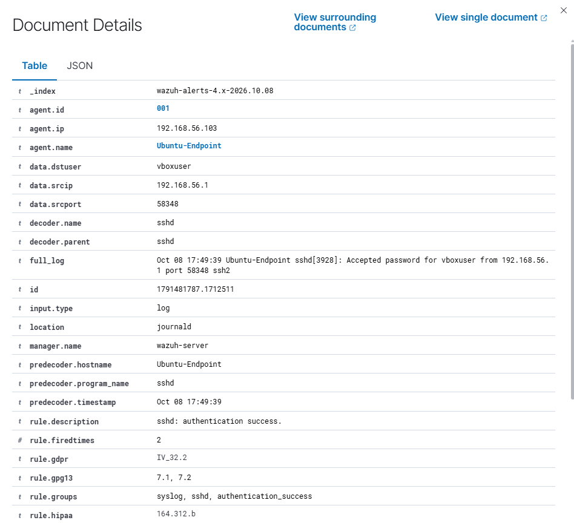

# Ubuntu — SSH Authentication

## Goal and method

Generate three controlled password failures from the host, then compare with a successful login. These are manual checks of native authentication detection, not a demonstrated brute-force correlation.

## Failed-authentication test

From host PowerShell:

```powershell
ssh -o PreferredAuthentications=password -o PubkeyAuthentication=no -o NumberOfPasswordPrompts=3 vboxuser@192.168.56.103
```

Enter an intentionally wrong password at each of the three prompts. On Ubuntu:

```bash
sudo journalctl -u ssh --since "5 minutes ago" --no-pager
```

The shared journal output recorded Failed password three times from 192.168.56.1. In the Dashboard:

```text
agent.name:"Ubuntu-Endpoint" AND rule.groups:sshd
```

## Successful-login control

Connect using the correct private credential, then exit:

```powershell
ssh vboxuser@192.168.56.103
```

Search:

```text
agent.name:"Ubuntu-Endpoint" AND rule.groups:sshd AND rule.groups:authentication_success
```

## Results and evidence

- Failed logins: native rule 5760, level 5, with source IP and vboxuser.
- Successful login: native rule 5715, level 3, Accepted password and authentication_success.
- The source event's location is journald.






## Limits

An individual password failure can be a typo. Three errors in one session do not demonstrate an automatically correlated brute-force alert. MITRE labels are native rule metadata, not a verdict that the successful login was malicious. No custom rule was added.
