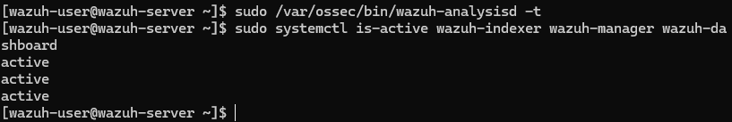
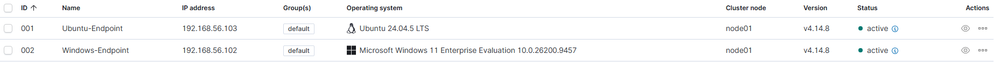
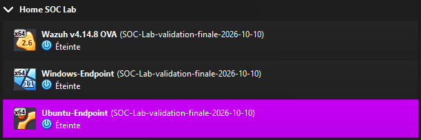

# Restart validation and backups

The manager syntax check completed without an error, and the Indexer, Manager and Dashboard reported active.

All three VMs were restarted. Both agents returned to active:

Two behaviors were repeated:

- Windows: cmd.exe /c whoami generated rule 100103 with T1033.
- Ubuntu: editing demo.conf generated rule 550 in realtime mode with changed hashes.

| Check | Evidence |
|---|---|
| Windows rule after reboot | [Rule 100103](screenshots/validation/whoami-rule.png) |
| Ubuntu modification after reboot | [FIM hashes](screenshots/validation/fim-hashes.png) |
| Persistent Windows settings | [WazuhSvc and Sysmon64 Running, logging value 1](screenshots/validation/windows-services.png) |

Reviewed agent exports and the four custom rules are included. Credentials, agent keys and virtual disks are excluded.

VirtualBox displayed a final snapshot label on all three stopped VMs:

A restore drill was not performed. Restart checks establish persistence of two monitored behaviors, not a rerun of every scenario.
